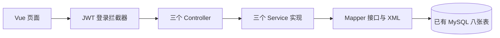

# 精简后的代码结构与汇报索引

先看 [精简版讲解](精简版讲解.md)，按登录、选配报价、下单三个流程讲。下面是实际文件索引，供被问到时查阅；52 个后端 Java 文件主要由实体和请求响应数据组成，不代表有 52 个业务模块。

## 后端文件

根包为 `src/main/java/com/lesaire/`。Service 接口声明方法，`service.impl` 实现业务；Mapper 不手写实现类，由 MyBatis 创建代理执行 XML SQL。

| 包 | 文件 | 作用 |
| --- | --- | --- |
| 根包 | `LesaireApplication.java` | 启动 Spring Boot |
| controller | `AccountController.java` | 注册登录、退出、当前用户、量体保存 |
| controller | `CatalogController.java` | 目录、报价、款式图片上传和读取 |
| controller | `OrderController.java` | 下单、用户和管理员订单、状态更新 |
| service | `AccountService.java` | 账号业务接口 |
| service | `CatalogService.java` | 目录、报价和图片业务接口 |
| service | `OrderService.java` | 订单业务接口 |
| service.impl | `AccountServiceImpl.java` | 查账号、核对密码、注册和保存量体 |
| service.impl | `CatalogServiceImpl.java` | 查有效目录、校验选配、计算价格、保存图片地址 |
| service.impl | `OrderServiceImpl.java` | 事务下单、重复请求、分页组装、归属和制作顺序 |
| mapper | `AccountMapper.java` | 用户和量体 SQL 接口 |
| mapper | `ShirtStyleMapper.java` | 制服款式查询和图片地址更新 |
| mapper | `FabricMapper.java` | 面料查询 |
| mapper | `CustomizationOptionMapper.java` | 定制选项查询与缺失选项插入 |
| mapper | `OrderMapper.java` | 订单、明细和选项读写、分页和状态更新 |
| config | `WebMvcConfig.java` | 注册登录拦截器 |
| config | `CatalogInitializer.java` | 空目录演示数据与缺失表单选项初始化 |
| config | `DemoAccounts.java` | 配置启用时补充缺少的演示用户名 |
| interceptor | `LoginInterceptor.java` | 校验 JWT、启用状态和 `/api/admin/` 的当前角色 |
| utils | `JwtUtils.java` | 签发与校验 token、内存退出撤销、启动实例标识 |
| utils | `PasswordHasher.java` | BCrypt 哈希及核对 |
| utils | `MeasurementJsonTypeHandler.java` | Java Map 与量体 JSON 快照转换 |
| utils | `CatalogUtils.java` | 配色标识、选项代码和预览类型转换 |
| utils | `ImageStorage.java` | 验证、保存和读取 JPG/PNG |
| common | `ApiExceptionHandler.java` | 把异常转换为 HTTP 状态和页面错误提示 |

### pojo：数据对象

| 文件 | 用途 |
| --- | --- |
| `Account.java` | `app_user` 用户实体，含密码哈希、角色和启用状态 |
| `CustomerMeasurement.java` | `customer_measurement` 量体实体 |
| `ShirtStyle.java` | `shirt_style` 制服款式实体 |
| `FabricMaterial.java` | `fabric` 面料实体 |
| `CustomizationOption.java` | `customization_option` 定制选项实体 |
| `CustomOrder.java` | `custom_order` 主表实体、稳定订单号和状态转换 |
| `OrderItem.java` | `custom_order_item` 明细、单价与尺寸快照 |
| `OrderItemOption.java` | `order_item_option` 选项名称、值和价格快照 |
| `CatalogEntity.java` | 目录实体公共字段 |
| `RegistrationRequest.java`、`LoginRequest.java` | 注册和登录输入及校验规则 |
| `LoginResponse.java`、`AccountView.java` | token 与账号响应，不返回密码哈希 |
| `Measurements.java`、`Customization.java` | 页面尺寸与定制方案 |
| `CatalogView.java` | 组合完整目录响应 |
| `ProductView.java`、`FabricView.java`、`ColorView.java` | 页面款式、面料和颜色 |
| `OptionPrices.java`、`Quote.java` | 常用选项加价和完整报价 |
| `OrderRequest.java` | 定制、尺寸、收货与请求标识 |
| `OrderView.java`、`OrderItemView.java` | 订单与明细响应，含选项快照 |
| `OrderPage.java` | 分页列表、总数、页码 |
| `OrderStatus.java`、`StatusChangeRequest.java` | 状态枚举和修改状态输入 |

这些简单数据对象有些使用 Java `record`，用于减少固定字段的构造器和访问方法代码，不是额外框架。

## XML、配置和前端

| 位置 | 文件 | 作用 |
| --- | --- | --- |
| resources/mapper | `AccountMapper.xml` | 用户、量体字段映射与 SQL |
| resources/mapper | `ShirtStyleMapper.xml`、`FabricMapper.xml` | 制服、图片地址和面料 SQL |
| resources/mapper | `CustomizationOptionMapper.xml` | 选项 SQL |
| resources/mapper | `OrderMapper.xml` | 主表、明细、选项 SQL，分页、批量查询和状态条件更新 |
| resources | `application.yml` | 公共配置、MyBatis XML 路径和 JWT 有效期 |
| resources | `application-mysql.yml` | 已有 MySQL 连接和连接池 |
| resources | `application-h2.yml`、`db/h2-schema.sql` | 独立测试及可选离线演示 |
| frontend/src | `App.vue` | 首页、目录、账号资料和导航 |
| frontend/src | `api.ts`、`types.ts` | Bearer 请求封装和数据类型 |
| frontend/src | `main.ts`、`style.css` | Vue 启动和页面样式 |
| components | `AuthDialog.vue` | 注册登录 |
| components | `StudioView.vue` | 选配报价、量体与确认下单 |
| components | `OrdersView.vue` | 分页订单、状态筛选、详情和更新 |
| components | `ProductImage.vue`、`GarmentPreview.vue` | 优先显示照片，缺少照片时 SVG 示意 |
| components | `ModalShell.vue` | 通用弹窗和键盘焦点 |
| 项目根目录 | `pom.xml`、`.run/Lesaire.run.xml` | Maven 依赖打包、IDEA 运行 |
| scripts | `Build.ps1`、`Run.ps1`、`Start.ps1`、`Stop.ps1` | 构建、前台运行、后台启动和停止 |
| frontend | `package.json`、`vite.config.ts`、`tsconfig.json` | 依赖、开发代理、前端构建与类型检查 |
| frontend | `playwright.config.mjs`、`e2e/`、`scripts/capture.mjs` | 浏览器验收和截图 |
| src/test/java | 测试类 | 验证报价、JWT、权限、订单事务与真实 MySQL；不属于业务执行流程 |

XML 的 `namespace` 对应 Mapper 完整名，SQL `id` 对应方法名。`@Param` 给参数命名，`#{}` 使用预编译绑定值，`resultMap` 对应列和 Java 字段。插入使用 `useGeneratedKeys` 得到主键，为明细关联服务。

## 三条调用链

**登录：** `AuthDialog.vue → AccountController → AccountServiceImpl → AccountMapper.xml → MySQL`。核对密码后 `JwtUtils` 返回两小时 JWT，`api.ts` 以后自动携带。`LoginInterceptor` 每次检查账号及当前数据库角色。退出在内存中撤销 token；重启生成新的实例标识，全部旧 token 失效，需要重新登录。

**选配和报价：** `StudioView.vue → CatalogController → CatalogServiceImpl → 目录 Mapper XML`。读取现有三个款式、三种面料，确认配色对应面料。单价等于基础价、面料加价和选项加价，总价等于单价乘数量。

**下单和进度：** `StudioView.vue → LoginInterceptor → OrderController → OrderServiceImpl → OrderMapper.xml`。下单重新报价，事务保存主表、明细与选项；稳定订单号、行锁和唯一约束防止重复。分页先读主表，再批量读取明细及选项。管理员依次推进待确认、裁剪、缝制、质检、发货、完成，用户只能操作自己的订单。

## 实现过程和边界

实际过程：备份并查看已有八张表 → 对应 pojo → 编写 Mapper/XML → 实现三个 Service → JWT 拦截器 → Vue 页面 → 测试打包。原库和已有款式继续使用，没有自动建库或扩展款式。精简前源码备份位于 `.local/backups/source-before-simplify-20261013-124713.zip`。

`@Transactional` 让订单主表、明细和选项一起成功或一起回滚。订单保存当时的名称、价格、尺寸和选项快照，后来改价格或量体不会改变已经保存的订单。部分面料展示信息仍关联当前目录。

新订单使用一项方案和一份尺寸，数量可多件，已有多明细历史订单仍能读取。支付、短信、库存扣减、真实物流和生产系统未接入，管理员手工维护进度。照片固定展示，不会因选配而自动改图。本次精简后的实际测试结果见 `docs/verification.md`。

## 常见追问

| 问题 | 回答 |
| --- | --- |
| 为什么还有不少文件？ | 大部分是表示八张表和接口输入输出的简单对象；业务只有账号、目录和订单三组 |
| 为什么 Mapper 没有实现类？ | MyBatis 根据接口和 XML 创建代理；ServiceImpl 才是手写业务实现 |
| JWT 和 BCrypt 分别做什么？ | JWT 用于登录后的身份凭证；BCrypt 用于密码哈希与核对 |
| 为什么重启需要登录？ | 每次启动生成新的实例标识，token 必须属于当前实例；撤销集合简化为内存存储 |
| 隐藏管理员按钮是否足够？ | 不够，拦截器还检查 `/api/admin/` 和数据库角色；订单层检查所属用户 |
| 为什么保留事务和快照？ | 它们保证订单不会只保存一半，旧订单不会随价格或量体修改而改变 |
| 辅助类需要逐行讲吗？ | 先讲调用链，工具只解释作用；被追问再打开相应方法 |
