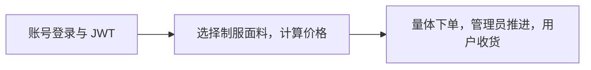

# 精简版：先讲明白这三个模块

核心功能是登录、制服选配报价和订单。图片、量体、权限分别支持这条流程，辅助类不需要逐行介绍。

## 在 IDEA 按这个顺序打开

下面文件位于 `src/main/java/com/lesaire/`，XML 位于 `src/main/resources/mapper/`。

1. `controller/AccountController.java`：用户提交账号密码，登录成功返回 token。
2. `service/impl/AccountServiceImpl.java`、`mapper/AccountMapper.java`、`AccountMapper.xml`：查用户，核对密码。
3. `utils/JwtUtils.java`、`interceptor/LoginInterceptor.java`：签发 token；后续请求先校验身份，再进入接口。
4. `controller/CatalogController.java`、`service/impl/CatalogServiceImpl.java`：读取现有款式、面料与价格，完成报价。单价等于基础价、面料价和选项价之和。
5. `controller/OrderController.java`、`service/impl/OrderServiceImpl.java`、`OrderMapper.xml`：重新报价，事务保存订单、明细和选项，检查归属并更新制作状态。

每一条业务都按 `Controller → Service → Mapper → XML → MySQL` 执行。Service 接口声明方法，`service.impl` 写具体规则，`pojo` 存数据；Mapper 的实现由 MyBatis 自动生成。

前端只先看 `App.vue` 的导航，`AuthDialog.vue` 的登录，`StudioView.vue` 的表单，以及 `OrdersView.vue` 的订单。`api.ts` 自动加 Bearer token。照片、SVG、弹窗和样式作为辅助组件，讲作用即可。

## 两分钟讲稿

大家好，我介绍的是莱赛尔餐饮服装定制平台。这个项目在 AI 辅助下完成，我按自己学过的 Spring Boot、MyBatis 和 JWT 拦截器整理了代码，重点理解登录、制服选配和订单三个模块。

代码采用三层架构。Controller 接收页面请求，Service 实现类负责业务规则，Mapper 接口和 XML 负责数据库查询。实体和请求数据放在 pojo，实际业务实现放在 service.impl。这样讲解时可以沿着一条请求往下看，不必把每个数据对象当成一个功能。

登录时，Controller 接收账号密码，Service 调用 Mapper 查询 MySQL，再核对密码哈希。成功后返回两小时有效的 JWT。前端保存 token，后续请求放到 Authorization 请求头。拦截器检查登录，管理员接口还检查数据库中的角色。退出会撤销当前 token，重启服务后需要重新登录。

定制页面读取数据库已有的制服和面料。选择配色、衣长、刺绣和数量后，后端计算报价。提交订单时再次计算价格，避免浏览器改金额。

订单主表、明细和选项使用事务一起保存，失败就回滚；重复请求返回已有订单。订单保存当时的尺寸和价格，修改量体档案不会改变旧订单。管理员按裁剪、缝制、质检、发货推进，用户确认收货。

项目使用已有八张表，没有重新建库，也没有增加款式。照片文件保存在本地，数据库保存地址。目前每次新订单使用同一份尺寸，支付、短信和实际物流尚未接入，进度由管理员维护。

演示时我会先登录，选择制服和面料，展示价格变化，再填写尺寸提交订单。随后切换管理员推进制作状态，最后由用户确认收货。通过这条流程，可以说明页面、接口和数据库如何配合，也能看出权限校验和订单规则实际生效。

## 被追问时记住三句话

- JWT 证明登录身份，BCrypt 处理密码，两者用途不同。
- `#{}` 绑定 SQL 参数；接口方法名对应 XML 的语句 `id`。
- 三层分工：Controller 接请求，Service 写规则，Mapper 读写数据库。
